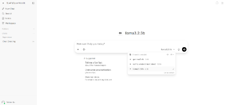
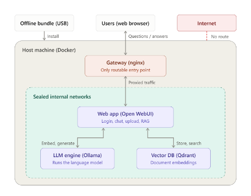

# SLAP: Secure Local AI Platform

A fully offline AI assistant with document Q&A, for organizations that cannot send their data to public AI services.

Penn State College of Engineering senior capstone, Fall 2026. Industry-sponsored team project. The source code is private; this page describes the system and my part in it.

> **Nothing leaves the machine it runs on.** The language model, the vector database and the web app have no route to the internet. This isn't a configuration setting that turns access off. The container runtime seals them off.

## Demo

*The chat interface running fully offline, with a picker for the locally installed models.*

## What it does

- Browser chat with conversation history, streaming replies, a model picker and file upload
- Answers questions about your own documents (RAG)
- Private chats and documents for each user; admins can publish shared libraries everyone can query
- Includes an offline install path: a flash-drive bundle for machines with no network access

## Architecture

| Service    | Role                                                         |
| ---------- | ------------------------------------------------------------ |
| nginx      | Single front door. The only container on a routable network. |
| Open WebUI | Everything the user sees: login, upload, chat.               |
| Ollama     | Runs the language model locally.                             |
| Qdrant     | Vector database holding document embeddings.                 |
| Apache Tika| Extracts text from uploaded documents.                       |

## Engineering highlights

- **Isolation built into the architecture.** The model, the vector database and the web app run on internal-only Docker networks, and nginx is the only routable entry point. We tested that a published port doesn't work on a sealed network instead of assuming it.
- **Proof instead of trust.** A verification script makes real outbound connection attempts from inside each network and reports what actually happens, instead of reading the config and trusting it.
- **Air-gapped install.** A ~10 GB bundle is built on a connected machine, carried over on a flash drive, and installed on a machine with no network.
- **Model and hardware benchmarking.** We compared open-source models on response quality (scored against test questions with known answers, checking source use and hallucinations), speed (tokens/sec), and RAM/VRAM use across hardware setups. The results became a matrix that recommends models based on the hardware an organization actually has.
- **Supply-chain integrity.** Model files are checked against their SHA256 hashes before loading, and every container, library, and model is pinned to a specific version that matches what is actually deployed.
- **Built to run without us.** Scheduled backups with a tested restore, and a manual offline upgrade process with a tested rollback in place of automatic updates. Install, operations, and maintenance guides were tested by following them on a clean environment.
- **Documented decisions.** Every architectural choice is recorded with its trade-offs, along with a scope document listing what was deliberately not built and why.
- **Sponsor-driven.** Weekly status reports and demos to the industry sponsor. Requests raised in those meetings, such as flash-drive deployment, admin model upload, OCR for scanned documents, and backups, became the roadmap.

## Results so far

- **Isolation:** an automated test that makes real outbound connection attempts could not reach the internet from any sealed component, on two separate machines.
- **Accuracy:** 8 of 8 test questions were answered from the correct passage, with the source shown, on a 15-page document that includes scanned pages and charts.
- **Speed:** a full answer takes about 15 seconds on a six-year-old laptop with no GPU, three times our 5-second target. Switching to a smaller model made answers 2.2× faster, and the target is under review with the sponsor.
- **Cost:** no license or cloud fees.
- **Sponsor:** the sponsor approved the working prototype, and all five requested features are built.

## How AI was used

We used Claude Code as a development assistant and kept a log of what it produced and what we corrected. For example, we overrode its laptop-first design so everything runs in Docker for portability. We also rejected an upload limit sized for developer laptops. And by testing live behavior instead of trusting the docs, we caught a false claim in our own documentation. The architecture reflects team decisions; the AI drafted options and code, and we reviewed, tested and changed them.

## My role

I was one of six developers, and we shared work across the whole stack. Areas I worked on with teammates include:

- Containerized the core AI stack, set up the first Docker Compose environment, and connected Open WebUI to Ollama for the first local proof of concept
- Configured document ingestion and answers that show which document they came from
- Verified data privacy and network isolation, and reviewed model-file integrity and pinned versions
- Loaded and verified models offline, added multi-model support, and ran speed and memory benchmarks
- Co-wrote the operations and secure-configuration guide and the maintenance and troubleshooting guide
- Took part in requirement and demo meetings with the sponsor

## Tech stack

Docker Compose · Ollama · Qdrant · Open WebUI · nginx · Apache Tika · Bash · PowerShell · GitHub Actions

## Status

Sponsor-approved working prototype. Still to do before handoff at the end of Fall 2026: full end-to-end testing, a backup-and-restore test on a clean machine, speed testing with multiple users, and measuring how often answers go beyond their sources. The team has tested the security posture, but it hasn't been independently audited.
